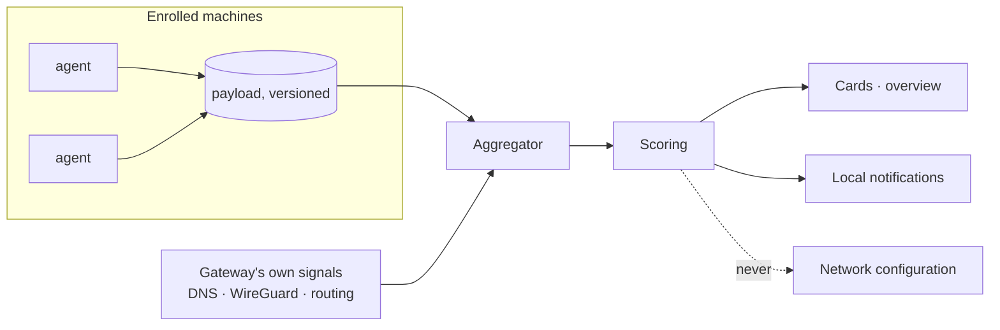

# Health Scoring and Signals

How Tunneld might score what it can see, aggregate what enrolled machines report, and say
something useful about it — without ever acting on the network itself.

> **Status: research.** Nothing here is built. This is the shape the work would take and the
> decisions that have to be made first, written down while the reasoning is fresh.

## Mental Model

Tunneld already knows more about a small network than anything else on it: DNS queries, routing
and filtering, URL routes, the WireGuard overlay, and every listener discovered on every enrolled
machine. Almost none of that is presented as a judgement. It is presented as state.

The proposal is one layer above state: **scores**. Per dimension, over time, with the signals that
produced them. A card that says *this peer's tunnel is degrading and here is why*, not a table that
says `handshake: 143s ago` and leaves the reader to know whether that is bad.

The gateway is an ARM SBC that owns the network it is judging. That single fact sets every
boundary below.

## Non-Goals

- **It does not act.** No routes, no firewall rules, no peer config, no DNS changes. The only thing
  it may produce is a notification.
- **It is never in the data path.** No packet waits on a score. If the scoring layer is wholly
  unavailable the box routes, resolves and tunnels exactly as it does today.
- **It does not depend on the internet to be useful.** Tunneld *is* the network; a judgement that
  requires a working connection is unavailable precisely when it is wanted.
- **Not a metrics stack.** Prometheus and friends already do time series. This is a small number of
  judged dimensions, not an observability platform.

## Score Is Not Confidence

The one distinction the whole design rests on. They are different numbers and collapsing them into
one loses the ability to threshold on either.

| | what it means | who produces it |
|---|---|---|
| **Score** | how healthy this dimension is, 0–100 | our own normalisation of our own signals |
| **Confidence** | how sure the judgement is | the model, or a rule's own certainty |

- low score, high confidence → **notify**
- low score, low confidence → **a card, and nothing more**
- high score, low confidence → collect more signal before believing it

A single blended "health: 62" is not actionable and cannot be argued with.

## What a Score Is Made Of

A score is per dimension and always decomposable. The card shows the number; opening it shows the
signals that produced it and their direction. A number nobody can interrogate gets ignored the
second it is wrong once.

Candidate dimensions, roughly in order of how confidently they can be judged:

| dimension | signals |
|---|---|
| Tunnel health | handshake age, endpoint churn, rx/tx asymmetry, MTU-shaped loss |
| Name resolution | query volume, NXDOMAIN rate, upstream latency, new-domain rate per device |
| Device behaviour | listeners appearing and disappearing, traffic shape against its own history |
| Reachability | who can currently reach whom, and since when |
| Fleet freshness | when each enrolled machine last reported |

## Stability Matters More Than Accuracy

A score recomputed from scratch on every poll jitters, and a jittering dashboard trains its owner
to stop reading it.

- Same inputs, normalised the same way, every time.
- Smooth over a window. The score should move because the world moved, not because it was asked
  again.
- Keep the history. A score is far more informative as a line than as a value — "72, and falling
  all afternoon" is a different statement from "72".

## Notifications Are the Only Output

Notifying is the right first and only action because it is reversible by ignoring it. It is also
where designs like this usually die, so the discipline is the product:

- **Fire on one threshold, clear on a lower one.** Anything else flaps.
- **Deduplicate by cause, not by event.** "This peer is unstable" once — not once per handshake.
- **Nothing repeats for an ongoing condition.** Say when it *changes*: got worse, recovered, went
  away.
- **Always say what was observed**, not only what was concluded. The observation is checkable; the
  conclusion is not.
- **Delivered locally.** The thing that warns you must not depend on the link it is warning about.

## Machines Reporting In

This is the largest change in the proposal: it makes Tunneld a fleet collector as well as a
gateway. Four decisions come before any collection.

1. **Version every payload.** Agents in the field will be older than the box. Decide now whether an
   unknown version is rejected or tolerated, and say so in the schema.
2. **Bound the storage first.** It is an ARM SBC with a modest disk. Retention and rollups are a
   design decision, not an optimisation: minutes for a day, hours for a month, days for a year.
3. **Offline is a state, not a gap.** A machine that stops reporting is one of the most interesting
   signals available. Absence must be first-class or it reads as missing data.
4. **It is someone's machine.** What an agent sends is a privacy decision before a technical one.
   Collect the least that makes a score meaningful, and let the owner see exactly what left their
   machine.

**The aggregation is worth building on its own.** With scoring switched off entirely, "every
machine, what it is doing, and when it last spoke" is already a product. Scores make it better;
they should not be what makes it work.

## Where a Model Fits

Evaluated: [typesafe.ai](https://typesafe.ai/)'s Jev — a decision model rather than a chat model.
It returns typed output with a calibrated confidence score, priced to be called constantly, and is
built around "act when confident, escalate when not".

That shape fits this problem better than a conversational model would. We do not want free-form
tool-calling anywhere near a router; we want narrow typed judgements with a number attached, which
our own code thresholds on. Its escalation path maps onto *show the owner a card* instead of
*act* — which is where this design already draws its line.

Conditions on using it:

- **Behind a seam.** One module, one function, a typed request and a typed answer. The vendor is
  early and must stay swappable.
- **A rule-based fallback that is always present.** Unreachable or low confidence falls back to
  thresholds we wrote. The box never waits on it.
- **"Zero hallucinations" is a claim about calibration, not a guarantee.** Treat confidence as a
  number to be measured against outcomes, not as a promise.

## Calibration Is the Real Deliverable

**Log every score with what happened next.** That record is the only thing that can answer whether
any of this was ever right, and it is the precondition for ever letting it act.

Without it the end state is a dashboard of confident numbers and no way to tell a good one from a
bad one.

## Open Questions

- What is the scoring interval, and is it the same for every dimension? (Tunnel health changes in
  seconds; device behaviour in days.)
- Does the gateway score its own signals only, or does a machine score itself and send a judgement?
  (Prefer the former: one normalisation, one place to fix.)
- What does the agent on an enrolled machine actually send, and how is that made visible to its
  owner?
- Where does the calibration record live, and for how long?
- Cost, once per-dimension scoring runs against a real fleet.

## What Would Make This Worth Building

In order. Each stage is useful alone, and none of them is allowed to act.

1. Aggregation and the overview: every machine, its state, when it last spoke.
2. Rule-based scores on the gateway's own signals, with history.
3. Notifications, with the discipline above.
4. A model behind the seam, advising only, with its judgements logged against outcomes.
5. Read the calibration record. Decide then — and only then — whether acting is ever on the table.
